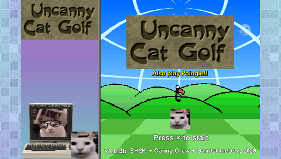
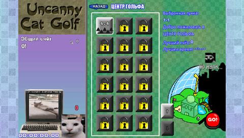
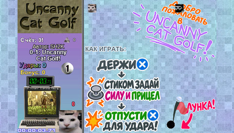

# Uncanny Cat Golf for PSP

[Русский](README.ru.md) · [RC21 downloads](https://github.com/SandstoneDev/UncannyCatGolf-psp/releases/tag/v1.0.3b-psp.076-rc21) · [Changelog](CHANGELOG.md)

Unofficial PSP port by **SandstoneDev**, based on the original **1.0.3b**. Current build: **0.7.6 / RC21**, native shared saves for the complete major-mode content inventory.

**The level editor suffers from severe slowdown on PSP and is currently barely usable. It is included as experimental content. Further editor work is deferred.** The main game also has remaining frame/audio stalls; this is not a stable 30/60 FPS or exact-parity claim.

## Included content

- All **113 campaign courses** across seven worlds, the map, results, ranks, profiles and campaign endings.
- Summer Villa, Club Canny, Mystery Phone, the friend/secret quest, costumes, rewards and story routes.
- **Endless Shuffle:** 82 course positions, including 10 unique courses and 72 campaign replays.
- Cat Artist/Copycat, Meowls, Uncanny Dash and Bort Bash; Sound Test with 58 entries.
- Eleven profile modifiers, the separate Peak Hunter mode, first-start introduction and 25 attract demonstrations.
- Experimental level editor and all 14 original ExampleWorld courses, with custom-world loading/saving and playtest.
- English and Russian in the main game. The editor defaults to English. PC Godot mods and FR/JA/RO/BI locales are outside this port's scope.

The content inventory is complete for the listed major modes and course sets. This does **not** mean every natural progression branch, effect or original-PC behavior has been exhaustively verified. See [known issues](docs/KNOWN_ISSUES.md) and [the audit summary](docs/RC21_AUDIT.md).

## Downloads and installation

Choose **one** game archive; both contain their required game assets. A PSP set up to run homebrew is required. The current hardware reference is PSP-3000; this release is not qualified for PSP-1000 or every firmware/model combination.

- [EBOOT ZIP](https://github.com/SandstoneDev/UncannyCatGolf-psp/releases/download/v1.0.3b-psp.076-rc21/Uncanny-Cat-Golf-1.0.3b-PSP-076-RC21-EBOOT.zip): extract the included `PSP` directory to the memory-card root. Keep the complete `PSP/GAME/UCG054` folder, including `EBOOT.PBP`, `storage.ucd` and `data`, together.
- [ISO ZIP](https://github.com/SandstoneDev/UncannyCatGolf-psp/releases/download/v1.0.3b-psp.076-rc21/Uncanny-Cat-Golf-1.0.3b-PSP-076-RC21-ISO.zip): extract the included `ISO` and `PSP` directories to the memory-card root. Launch the ISO from Game → Memory Stick. The `PSP` sidecars contain the optional offline manual.
- [Optional native 100% save](https://github.com/SandstoneDev/UncannyCatGolf-psp/releases/download/v1.0.3b-psp.076-rc21/Uncanny-Cat-Golf-1.0.3b-PSP-076-RC21-Native-100-Percent-Save.zip): **separate download**, excluded from both game archives. Back up `PSP/SAVEDATA/UCGP00054GAME` before installing: it replaces all eight profiles and shared progress. This is a generated unlock save; its README documents the completion markers.
- [SHA-256 checksums](https://github.com/SandstoneDev/UncannyCatGolf-psp/releases/download/v1.0.3b-psp.076-rc21/SHA256SUMS.txt) cover all three archives. The release also provides the ISO checksum.

Both formats share native progress in **`PSP/SAVEDATA/UCGP00054GAME`**, regardless of the EBOOT folder name. Settings, artwork and custom worlds remain in `PSP/GAME/UCG054` for a standard installation. Keep both locations when updating. A renamed EBOOT directory changes only the ordinary configuration/user-content location.

Progress from RC17/RC18 in `PSP/GAME/UCG054` is imported on first launch when no native entry exists. EBOOT and ISO then share `PSP/SAVEDATA/UCGP00054GAME`. Keep the old files as recovery copies and read [save migration](docs/SAVES.md) before upgrading or downgrading. Older 053 directories are not moved automatically.

## Controls

Use the D-pad for ordinary menus and pause choices; use the stick for precise pointer actions in Paint and the editor. Gameplay aiming is independent of the pointer's screen boundary. Hold ×, aim with the stick or D-pad, then release × to shoot. Existing sensitivity/inversion settings apply.

## Screenshots

| Title | Campaign map | Tutorial |
|---|---|---|
|  |  |  |

[Build the current Main and Editor from source](https://github.com/SandstoneDev/UncannyCatGolf-psp/blob/v1.0.3b-psp.076-rc21/src/README.md).

## Credits and publication

Original game by **SH2K (SlappyHappy2000), Haze Weathers, mbx8rt, Penny Rigate, greenhead352, and bibizu**. PSP port by **SandstoneDev**.

Game builds with assets are published with the original developer's permission, as confirmed by the port maintainer. Original assets retain their respective credits and rights; this is not a blanket licence to redistribute them separately.

[Original game and PC downloads](https://slappyhappy2000.itch.io/uncanny-cat-golf) · [Original game Discord](https://discord.gg/bkZM7cUwNq)
