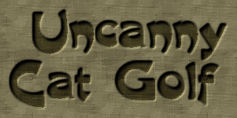
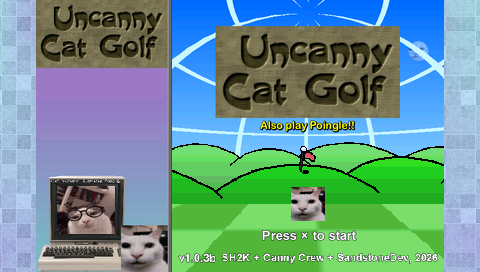
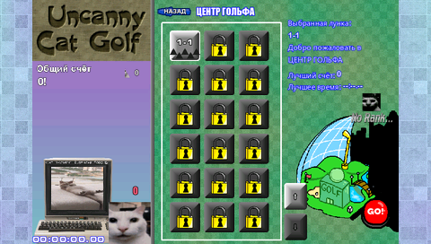
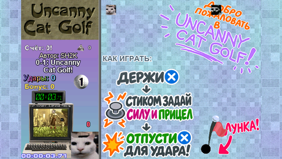

# Uncanny Cat Golf for PSP

[Русский](README.ru.md) · [Downloads](https://github.com/SandstoneDev/UncannyCatGolf-psp/releases)

An unofficial PSP port by **SandstoneDev**, based on the original **1.0.3b**. This is the first PSP release, **port build 053**.

## What's playable

- All **113 campaign holes** across seven worlds, including the tutorial, world results, and campaign endings.
- Campaign map, scores, ranks, records, and unlockable rewards used by the campaign.
- English and Russian menus and text, PSP controls, multiple profiles, and save entries in the PSP's Saved Data Utility.

## Install

Download `Uncanny-Cat-Golf.iso` from [GitHub Releases](https://github.com/SandstoneDev/UncannyCatGolf-psp/releases). On a PSP set up to run homebrew ISO images, copy it to the `ISO` folder at the root of the memory card and launch **Uncanny Cat Golf** from **Game → Memory Stick**. PPSSPP can open the ISO directly. The release includes a SHA-256 checksum.

## Screenshots

| Title screen | Campaign map | Tutorial |
| --- | --- | --- |
|  |  |  |

## Known issues and roadmap

This first PSP build still has bugs and performance issues. There can be short frame or audio stalls, particularly around the title screen, some transitions, and victory animations. Further releases will improve performance and bring the port closer to the PC version.

- Finish and integrate Summer Villa, costumes, Club Canny, Mystery Phone, and the secret quest. Work on these features is underway in a separate development build.
- Add standalone minigames, Sound Test, Endless Shuffle, remaining modifiers, and the level editor with custom worlds.
- Restore the original hold-to-skip behavior and animation on PSP, and continue checking UI, input, and effects against the PC release.

[Building the PSP executable](src/README.md)

## Credits

Original game by SH2K (SlappyHappy2000), Haze Weathers, mbx8rt, Penny Rigate, greenhead352, and bibizu. PSP port by SandstoneDev.

[Original game and PC downloads](https://slappyhappy2000.itch.io/uncanny-cat-golf) · [Original game Discord](https://discord.gg/bkZM7cUwNq)
