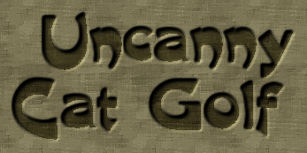
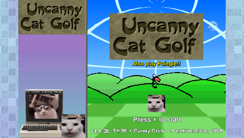
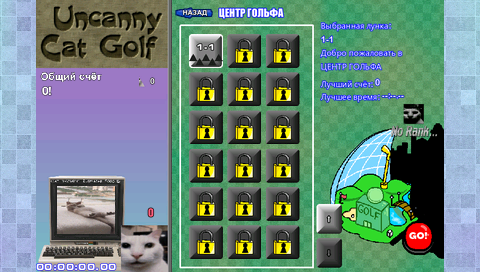
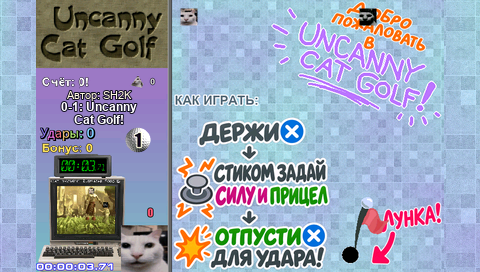

# Uncanny Cat Golf для PSP

[English](README.md) · [Скачать](https://github.com/SandstoneDev/UncannyCatGolf-psp/releases)

Неофициальный порт от **SandstoneDev** на основе оригинальной версии **1.0.3b**. Первый релиз для PSP, **сборка порта 053**.

## Что уже работает

- Все **113 лунок кампании** в семи мирах, от обучения до финала. Есть итоги миров и развязки кампании.
- Карта кампании, очки, ранги, рекорды и награды, задействованные в кампании.
- Русский и английский языки, управление с кнопок PSP, несколько профилей и сохранения в меню PSP.

## Установка

Скачайте `Uncanny-Cat-Golf.iso` со [страницы релизов](https://github.com/SandstoneDev/UncannyCatGolf-psp/releases). На PSP с поддержкой запуска домашних ISO скопируйте образ в папку `ISO` в корне карты памяти и запустите **Uncanny Cat Golf** через **Игра → Memory Stick**. В PPSSPP можно открыть ISO напрямую. На странице релиза есть контрольная сумма SHA-256.

Порт поддерживает **PSP-1000 (Fat)**. Совместимость с этой моделью проверена в PPSSPP. Релиз также проверен на реальной PSP-3000.

## Скриншоты

| Заставка | Карта кампании | Обучение |
| --- | --- | --- |
|  |  |  |

## Известные проблемы и планы

Это первая сборка для PSP. В ней ещё есть баги и проблемы с оптимизацией. На заставке, отдельных переходах и анимациях победы возможны короткие зависания игры и звука. В следующих выпусках будем исправлять ошибки, улучшать производительность и сверять порт с ПК-версией.

- Доделать и включить Летнюю виллу, костюмы, Club Canny, Mystery Phone и секретный квест. Часть этого контента уже работает в отдельной сборке разработки.
- Добавить отдельные мини-игры, Sound Test, Endless Shuffle, остальные модификаторы, редактор и пользовательские миры.
- Вернуть удержание кнопки для пропуска лунки с оригинальной анимацией и продолжить сверку интерфейса, управления и эффектов.

[Сборка исполняемого файла PSP](src/README.md)

## Авторы

Оригинальная игра — SH2K (SlappyHappy2000), Haze Weathers, mbx8rt, Penny Rigate, greenhead352 и bibizu. Порт для PSP — SandstoneDev.

[Оригинальная игра и загрузки для ПК](https://slappyhappy2000.itch.io/uncanny-cat-golf) · [Discord оригинальной игры](https://discord.gg/bkZM7cUwNq)
