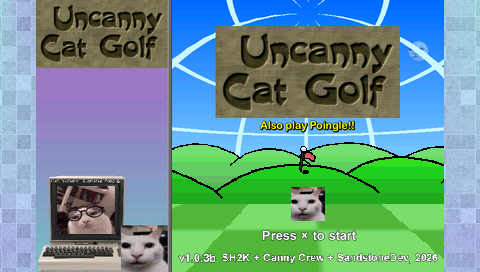
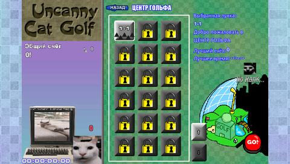
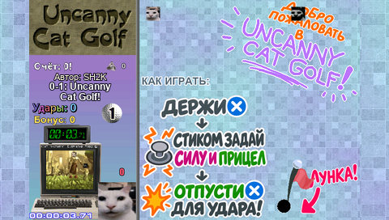

# Uncanny Cat Golf для PSP

[English](README.md) · [Загрузки RC21](https://github.com/SandstoneDev/UncannyCatGolf-psp/releases/tag/v1.0.3b-psp.076-rc21) · [Список изменений](CHANGELOG.ru.md)

Неофициальный порт **SandstoneDev** на основе оригинала **1.0.3b**. Текущая версия — **0.7.6 / RC21**, общий нативный сейв и весь основной игровой контент.

**Редактор уровней на PSP очень сильно тормозит и сейчас практически непригоден для комфортной работы. Он включён как экспериментальный модуль; дальнейшая работа над ним пока отложена.** В основной игре тоже остаются задержки кадров/звука. Стабильные30/60FPS и точное совпадение с PC не заявляются.

## Что включено

- Все **113 лунок кампании** в семи мирах, карта, результаты, ранги, профили и финалы кампании.
- Summer Villa, Club Canny, Mystery Phone, квест друга и секретные маршруты, костюмы, награды и сюжетные цепочки.
- **Endless Shuffle:** 82 позиции, включая10уникальных полей и72повторных кампанийных.
- Cat Artist/Copycat, Meowls, Uncanny Dash и Bort Bash; Sound Test на58позиций.
- 11профильных модификаторов, отдельный Peak Hunter, первое вступление и25автодемонстраций.
- Экспериментальный редактор и 14 оригинальных полей ExampleWorld, загрузка/сохранение своих миров и playtest.
- Английский и русский в основной игре. Редактор по умолчанию английский. PC-моды Godot и локали FR/JA/RO/BI в объём этого порта не входят.

Перечисленные основные режимы и наборы уровней перенесены. Это **не означает**, что уже проверены все естественные открытия, эффекты и сочетания механик оригинала. Подробности — в [известных проблемах](docs/KNOWN_ISSUES.md) и [предрелизном аудите](docs/RC21_AUDIT.md).

## Загрузка и установка

Выберите **один** архив игры; необходимые ассеты включены в оба. Нужна PSP, настроенная для запуска homebrew. Основная проверенная аппаратная модель — PSP-3000; пригодность этой версии для PSP-1000 и всех сочетаний прошивок/моделей не подтверждена.

- [EBOOT ZIP](https://github.com/SandstoneDev/UncannyCatGolf-psp/releases/download/v1.0.3b-psp.076-rc21/Uncanny-Cat-Golf-1.0.3b-PSP-076-RC21-EBOOT.zip): распакуйте папку `PSP` в корень карты. Сохраняйте целиком `PSP/GAME/UCG054`, включая `EBOOT.PBP`, `storage.ucd` и `data`.
- [ISO ZIP](https://github.com/SandstoneDev/UncannyCatGolf-psp/releases/download/v1.0.3b-psp.076-rc21/Uncanny-Cat-Golf-1.0.3b-PSP-076-RC21-ISO.zip): распакуйте папки `ISO` и `PSP` в корень карты. Запускайте образ из Игра → Memory Stick. В папке `PSP` лежит необязательное офлайн-руководство.
- [Необязательный нативный сейв 100%](https://github.com/SandstoneDev/UncannyCatGolf-psp/releases/download/v1.0.3b-psp.076-rc21/Uncanny-Cat-Golf-1.0.3b-PSP-076-RC21-Native-100-Percent-Save.zip): **отдельная загрузка**, отсутствует в обоих архивах игры. Сначала скопируйте `PSP/SAVEDATA/UCGP00054GAME` в резервную копию: установка заменяет все восемь профилей и общий прогресс. Это сгенерированный сейв открытий; маркеры завершения описаны в его README.
- [Контрольные суммы SHA-256](https://github.com/SandstoneDev/UncannyCatGolf-psp/releases/download/v1.0.3b-psp.076-rc21/SHA256SUMS.txt) для всех трёх архивов. Также опубликована сумма исходного ISO.

Обе версии используют **общий нативный прогресс `PSP/SAVEDATA/UCGP00054GAME`**, независимо от имени папки EBOOT. Настройки, рисунки и свои миры стандартной установки остаются в `PSP/GAME/UCG054`. При обновлении сохраняйте обе папки. Переименование папки EBOOT влияет только на расположение обычных настроек и пользовательского контента.

Прогресс RC17/RC18 из `PSP/GAME/UCG054` переносится при первом запуске, если нативного сейва ещё нет. Затем ISO и EBOOT совместно используют `PSP/SAVEDATA/UCGP00054GAME`. Старые файлы сохраняются для восстановления. Перед обновлением или откатом прочитайте [инструкцию по сейвам](docs/SAVES.md). Папки старой версии 053 автоматически не перемещаются.

## Управление

Обычные меню и пауза управляются крестовиной; точные действия в Paint и редакторе — стиком/курсором. Натяжение удара не зависит от границы курсора: удерживайте ×, направьте стик или крестовину, отпустите ×. Настройки чувствительности и инверсии сохраняются.

## Скриншоты

| Заставка | Карта кампании | Обучение |
|---|---|---|
|  |  |  |

[Сборка текущего Main и Editor из исходников](https://github.com/SandstoneDev/UncannyCatGolf-psp/blob/v1.0.3b-psp.076-rc21/src/README.md).

## Авторы и публикация

Оригинальная игра — **SH2K (SlappyHappy2000), Haze Weathers, mbx8rt, Penny Rigate, greenhead352 и bibizu**. Порт для PSP — **SandstoneDev**.

Готовые сборки с ассетами публикуются с разрешения разработчика оригинала, подтверждённого владельцем порта. Права и авторство исходных ресурсов сохраняются; это не общая лицензия на их отдельное распространение.

[Оригинальная игра и загрузки для PC](https://slappyhappy2000.itch.io/uncanny-cat-golf) · [Discord оригинальной игры](https://discord.gg/bkZM7cUwNq)
